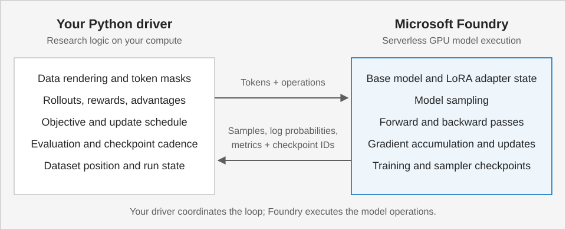
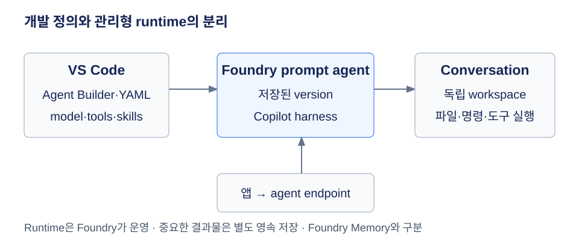
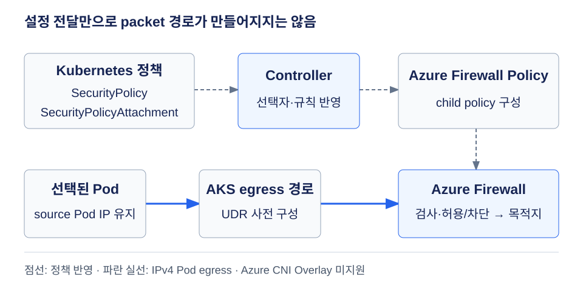
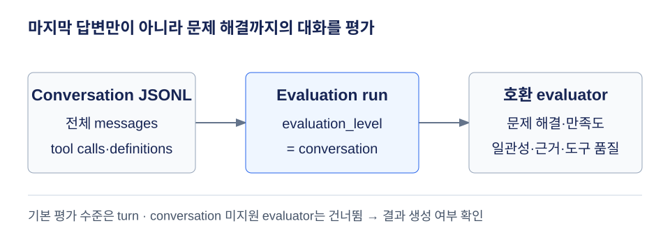

# Azure 일일 업데이트 브리핑 — 2026-11-21

**Foundry Programmed Training**은 GPU 인프라를 직접 관리하지 않고도 Python에서
학습 루프를 제어하게 합니다. **VS Code의 Copilot harness 지원**은 관리형 에이전트의
도구·skill 구성을 개발 환경으로 가져오며, **Multi-turn evaluation**은 개별 답변을 넘어
대화 전체의 문제 해결 여부를 평가합니다. **Azure Firewall for Containers**는
AKS Pod·namespace 선택자를 Azure Firewall 규칙에 연결합니다.

**이번 보고서의 업데이트**

- **AI & Apps:** [Foundry — Programmed Training Public Preview](#programmed-training) ·
  [Foundry Toolkit — Copilot harness Public Preview](#copilot-harness) ·
  [Foundry — Multi-turn evaluation Public Preview](#multi-turn-evaluation) ·
  [Azure Functions — OpenAI extension Retirement](#functions-openai-retirement) ·
  [Foundry Canvas·VS Code — Governance policy guidance GA](#governance-guidance)
- **Infra:** [Azure Firewall for Containers Public Preview](#firewall-containers) ·
  [Azure Cobalt 200 VMs — GA 공지 갱신](#cobalt-200)

## 주요 업데이트

### Microsoft Foundry — Programmed Training Public Preview { #programmed-training }

**학습 인프라는 Foundry에 맡기고, 학습 방법 자체는 Python으로 제어**

모델을 업무에 맞게 조정할 때 Managed Training은 데이터와 설정을 제출하면
서비스가 학습 작업을 실행하는 방식입니다. 강화 학습용 grader를 지정할 수도 있지만,
응답을 수집하는 과정이나 gradient를 누적하고 반영하는 시점까지 실험하려면
더 세밀한 제어가 필요합니다.
Programmed Training은 **open-weight 모델의 post-training 루프를 직접 작성하는 API**입니다.
사용자의 Python driver가 실험을 조율하고, Foundry가 serverless GPU에서
모델 sampling과 LoRA adapter 갱신을 실행합니다.
학습 서버 운영과 연구용 제어권을 분리한다는 점이 핵심입니다.
[기능과 역할 구분](https://learn.microsoft.com/azure/foundry/fine-tuning/programmed-training/overview)

  

*출처: Microsoft Learn,
[Programmed Training — Who does what](https://learn.microsoft.com/azure/foundry/fine-tuning/programmed-training/overview#who-does-what).
공식 원본이며, 가로로 스크롤하거나 그림을 선택해 크게 볼 수 있습니다.*

- **학습 신호 구성:** driver가 rollout을 모으고 reward·advantage와 token mask를
  계산합니다. 어떤 token을 학습에 반영할지 사용자가 결정합니다.
- **계산과 갱신 분리:** `forward_backward`는 gradient를 계산·누적하고,
  `optim_step`이 이를 adapter에 반영합니다. 두 동작을 하나의 고정된 작업으로 묶지 않습니다.
- **다음 실험:** 갱신한 adapter의 sampler weights를 새로 준비한 뒤 응답을 생성하고,
  별도로 남겨 둔 평가 데이터에서 baseline과 비교합니다.
- **중단·재개:** training checkpoint에는 adapter와 optimizer state를 저장합니다.
  데이터셋의 처리 위치 등 실험 상태는 driver가 별도로 관리해야 합니다.

같은 기본 연산으로 강화 학습뿐 아니라 supervised learning·preference learning·
distillation·custom-loss 실험도 구성할 수 있습니다.
**보상이 높아졌다고 실제 업무 품질이 개선된 것은 아니며**, 학습 중 sampling 결과와
최종 serving 환경의 동작도 별도로 검증해야 합니다.

**접근 조건·가용성**

참여 신청 후 **명시적인 접근 승인**을 받아야 합니다.
지원 모델은 `gpt-oss-20b`, `gpt-oss-120b`, `Qwen3.6-35B-A3B`,
`Qwen3.8-27B`, `Muse-Glimmer-30B`이며, 모델별 학습·배포 조합이 다릅니다.
Foundry의 모든 fine-tuning 모델을 이 API에서 사용할 수 있는 것은 아닙니다.

- **미주:** Canada East, East US, East US 2, North Central US, West US 3.
- **유럽:** Sweden Central, Switzerland North, UK South.
- **아시아·태평양:** Australia East, **Korea Central**.
- **중동:** UAE North.

이는 **Global training을 사용할 Foundry project의 리전**입니다.
Global training은 데이터 소재지를 보장하지 않으므로, Korea Central project를 선택해도
한국 안에서만 학습한다고 해석하면 안 됩니다.
Public Preview는 SLA 없이 제공되며 production 용도로 권장되지 않습니다.

**공식 자료:**
[프리뷰 발표](https://azure.microsoft.com/updates?id=581713) ·
[학습 루프·checkpoint 동작](https://learn.microsoft.com/azure/foundry/fine-tuning/programmed-training/overview) ·
[모델·리전·배포 조합](https://learn.microsoft.com/azure/foundry/fine-tuning/overview)

### Foundry Toolkit for VS Code — Microsoft Copilot harness Public Preview { #copilot-harness }

**Prompt agent의 다단계 실행 환경을 Foundry가 운영**

에이전트가 파일을 읽고 도구를 호출하며 여러 단계를 수행하려면 모델 외에도
작업 이력과 실행 환경을 조율하는 runtime이 필요합니다.
Microsoft Copilot harness는 이러한 동작을 Foundry가 운영하는
**prompt agent용 관리형 runtime**입니다.
프레임워크·middleware·dependency와 process model을 직접 소유하는 hosted agent와는
선택 기준이 다릅니다.
이번 발표는 Foundry Toolkit의 Agent Builder에서 harness 기반 prompt agent의
도구·skill을 구성하고, 로컬 YAML 정의를 편집해 Foundry에 배포하며,
배포된 version을 VS Code에서 실행하는 개발 흐름을 Public Preview로 제공합니다.

  

*공식 문서 기반 재구성:
[Copilot harness의 runtime·workspace·도구](https://learn.microsoft.com/azure/foundry/agents/how-to/use-tools-skills-copilot-harness)와
[VS Code 지원 발표](https://azure.microsoft.com/updates?id=581468).
작은 화면에서는 가로로 스크롤하고, 그림을 선택하면 크게 볼 수 있습니다.*

- **정의와 실행 분리:** model·instructions·tools·skills를 구성하고,
  애플리케이션은 **agent의 Responses endpoint**로 호출합니다.
  로컬 YAML을 편집한다고 runtime이 개발자 PC에서 실행되는 것은 아닙니다.
- **Conversation별 작업 공간:** 대화마다 history와 workspace가 분리됩니다.
  Foundry가 sandbox의 idle·resume·교체를 관리하며,
  중요한 결과물은 Foundry Files 같은 별도 영속 저장소에 보관합니다.
- **기본 실행 능력:** file read·write, shell, URL 내용 조회용 Web, subagents가
  기본 활성화됩니다. 서비스·조직 정책과 설정으로 사용 범위를 제한할 수 있습니다.
- **Skill 재사용:** version이 있는 skill을 agent 정의에 연결합니다.
  개별 agent version은 변경되지 않는 skill version을 참조합니다.

**생성·보안 제약**

초기 프리뷰에서는 **새 agent를 생성할 때만 harness를 선택**하며,
기존 agent의 harness를 version 갱신으로 바꿀 수 없습니다.
Reasoning·tool calling을 지원하는 model이 필요하고 BYOM은 지원하지 않습니다.
**Foundry Memory도 현재 지원하지 않으며**, conversation history나 workspace 파일과는
다른 기능입니다.

Shell은 파일·네트워크에 접근할 수 있으므로, Shell을 켠 채 file read·Web 도구만 끄는
설정은 엄격한 보안 경계가 아닙니다. MCP 도구의 `require_approval` 설정도
harness built-in 도구의 승인 정책과 구분해야 합니다.
[도구 권한·제한](https://learn.microsoft.com/azure/foundry/agents/how-to/use-tools-skills-copilot-harness#configure-harness-tools)

**지원 project 리전**

- **미주:** Brazil South, Canada Central, Canada East, Central US, East US,
  North Central US, West US, West US 3.
- **유럽:** France Central, Germany West Central, Italy North, Norway East,
  Poland Central, Spain Central, Sweden Central, UK South, West Europe.
- **아시아·태평양:** Australia East, Japan East, **Korea Central**, Southeast Asia, South India.

리전에서 harness를 제공하더라도 선택한 model·tool의 지원 조건은 따로 충족해야 합니다.
Public Preview는 SLA 없이 제공되며 production 용도로 권장되지 않습니다.

**공식 자료:**
[VS Code 프리뷰 발표](https://azure.microsoft.com/updates?id=581468) ·
[runtime·workspace·도구 동작](https://learn.microsoft.com/azure/foundry/agents/how-to/use-tools-skills-copilot-harness) ·
[가용성·호환성](https://learn.microsoft.com/azure/foundry/agents/concepts/limits-quotas-regions#microsoft-copilot-harness-preview)

### Azure Firewall for Containers — Public Preview { #firewall-containers }

**AKS workload의 label을 Azure Firewall 정책으로 연결**

기존 AKS의 Azure Firewall 구성은 네트워크 경로와 방화벽 규칙을 함께 관리해야 했습니다.
Pod가 바뀔 때마다 달라지는 IP 대신 workload의 의미로 정책 대상을 선택하려면
Kubernetes 객체와 방화벽 사이의 연결도 필요합니다.
Azure Firewall for Containers는 **Pod·namespace selector를 사용하는 Kubernetes
custom resource를 Azure Firewall 구성으로 변환**합니다.
Azure Firewall Controller가 정책 반영을 담당하므로 Kubernetes 쪽에서
workload 단위의 outbound 규칙을 선언할 수 있습니다.
단, 정책 객체를 만드는 것만으로 트래픽이 자동으로 방화벽을 통과하는 것은 아닙니다.

  

*공식 문서 기반 재구성:
[구성 모델·라우팅·정책 연결](https://learn.microsoft.com/azure/firewall/deploy-firewall-for-containers).
설정 전달과 실제 packet 경로를 구분했습니다. 그림을 선택하면 크게 볼 수 있습니다.*

- **선택과 규칙:** `SecurityPolicy`가 Pod·namespace selector와 network·application
  rules 등을 정의합니다. `AzureFirewall`은 방화벽 배포를 만들고 관리합니다.
- **연결:** `SecurityPolicyAttachment`가 정책·방화벽·보호할 AKS subnet을 연결합니다.
  Controller는 참조한 정책들을 child Azure Firewall Policy로 구성합니다.
- **실제 통신:** egress가 방화벽을 거치도록 라우팅을 먼저 준비합니다.
  방화벽에 도달할 때 source가 node IP가 아닌 **Pod IP로 유지**돼야 selector 기반
  규칙을 적용할 수 있습니다.
- **반영 확인:** Attachment의 `Deployment` condition reason이 `Ready`인지 확인합니다.
  정책 변경의 수렴과 새 Pod의 label 반영은 별도로 관찰해야 합니다.

**프리뷰 범위는 IPv4 Pod egress**입니다.
Azure CNI의 VNet Pod IP를 사용해야 하며 **Azure CNI Overlay는 지원하지 않습니다**.
클러스터당 Attachment·방화벽 각각 하나, 방화벽당 클러스터 하나로 제한됩니다.
기본 생성은 Premium SKU이며 기존 Standard SKU를 사용할 수도 있지만,
Premium 전용 IDPS·TLS inspection·URL filtering은 사용할 수 없습니다.

첫 정책 연결 시 Controller가 Pod SNAT를 끄므로,
**라우팅을 준비하기 전에 Attachment를 적용하면 outbound 연결을 잃을 수 있습니다.**
격리된 평가 환경에서 기존 경로와 rollback 계획을 먼저 확인해야 합니다.
[라우팅 순서·제한](https://learn.microsoft.com/azure/firewall/deploy-firewall-for-containers#route-aks-traffic-through-the-firewall)

**지원 리전**

- **미주:** Central US, West Central US, Central US EUAP, East US 2 EUAP.
- **유럽:** UK South.
- **아시아:** East Asia.

Azure public cloud의 프리뷰 구독에서 활성화된 리전을 사용해야 합니다.
**Korea Central·Korea South는 지원 목록에 없습니다.**

**공식 자료:**
[프리뷰 발표](https://azure.microsoft.com/updates?id=581963) ·
[Controller·지원 조건·실제 egress 경로](https://learn.microsoft.com/azure/firewall/deploy-firewall-for-containers)

### Microsoft Foundry — Multi-turn evaluation Public Preview { #multi-turn-evaluation }

**각 답변의 품질에서 대화 전체의 문제 해결 여부로 평가 범위 확대**

개별 답변이 정중하고 사실에 맞더라도 대화가 성공한 것은 아닐 수 있습니다.
에이전트가 실패한 조치를 반복하거나 사용자의 후속 요청을 반영하지 않으면,
각 turn의 점수만으로는 전체 실패를 찾기 어렵습니다.
Multi-turn evaluation은 전체 conversation을 하나의 평가 단위로 다룹니다.
Foundry SDK에서 turn별 평가와 conversation 전체 평가를 선택해
task completion·customer satisfaction·coherence·groundedness·tool use quality 등을
검토할 수 있습니다.
에이전트의 최종 응답뿐 아니라 그 응답에 이른 도구 사용과 대화 흐름을 함께 살핍니다.

  

*공식 문서 기반 재구성:
[Conversation dataset 평가](https://learn.microsoft.com/azure/foundry/observability/how-to/cloud-evaluation-conversations).
그림을 선택하면 크게 볼 수 있습니다.*

- **입력:** JSONL 한 줄에 완전한 conversation의 `messages` 배열을 넣습니다.
  도구 사용을 평가할 때는 tool call·결과와 `tool_definitions`도 제공합니다.
- **평가 단위:** run에 `evaluation_level="conversation"`을 명시합니다.
  생략하면 기본값은 `"turn"`이므로, multi-turn 데이터를 넣는 것만으로
  대화 전체 평가가 켜지지는 않습니다.
- **평가 기준:** task completion과 customer satisfaction은 해결 여부와 사용자 경험을,
  coherence·groundedness·tool use quality는 일관성·근거·도구 사용 품질을 살핍니다.
- **결과 해석:** evaluator의 `supported_evaluation_levels`를 확인합니다.
  Conversation 평가를 지원하지 않는 evaluator는 **run 실패 대신 건너뛰므로**,
  실행 성공만 확인하지 말고 필요한 평가 결과가 실제 생성됐는지 검토해야 합니다.

이 기능은 답변 하나씩 통과하는 테스트로 놓치던 반복 실패와 미해결 대화를
회귀 평가에 포함할 수 있게 합니다. 기존 응답 단위 평가를 대체하기보다,
업무 완료까지의 경로를 검사하는 평가를 추가하는 데 의미가 있습니다.

**공식 자료:**
[프리뷰 발표](https://azure.microsoft.com/updates?id=581746) ·
[데이터 형식·평가 수준·evaluator 호환성](https://learn.microsoft.com/azure/foundry/observability/how-to/cloud-evaluation-conversations)

## 대응이 필요한 업데이트

### Azure Functions — OpenAI extension Retirement { #functions-openai-retirement }

**지원 종료: 2027-04-20 · 관련 확장 사용 여부 확인 필요**

종료 대상은 Azure Functions 전체나 OpenAI API가 아니라,
AI 기능을 trigger·binding으로 연결하는 **Azure Functions OpenAI extension**입니다.
사용 중인 binding을 식별하고 시나리오에 맞는 **OpenAI·Microsoft Foundry·
Azure AI Search SDK 직접 호출로 기한 전에 이전**해야 합니다.

- **Non-.NET:** preview extension bundle **4.60.0 이상에는 해당 확장이 없습니다**.
  기존 앱은 `[4.*, 4.60.0)` 범위의 이전 bundle을 사용할 수 있습니다.
- **.NET:** 해당 NuGet package 직접 참조로 실행을 계속할 수 있지만,
  package를 유지하는 것이 지원 연장은 아닙니다.
- **종료 이후:** security update·patch·기술 지원이 중단됩니다.
  이전 bundle 고정도 이 기한을 연장하지 않으므로 영구 대응으로 삼지 않습니다.

**공식 자료:**
[지원 종료·권고 조치](https://azure.microsoft.com/updates?id=579952) ·
[확장 범위·bundle·NuGet 안내](https://learn.microsoft.com/azure/azure-functions/functions-bindings-openai)

## 기타 업데이트

### Foundry Canvas·VS Code — Governance policy guidance GA { #governance-guidance }

**GA:** agent type·model·toolbox·guardrail에 관련된 정책과 경고·대응 경로를
개발 화면에서 보여 줍니다. VS Code에서 agent·toolbox를 저장할 때 허용되지 않은
도구를 정책별 오류로 식별하고 Foundry portal의 상세 정책으로 연결합니다.
정책 관리는 Foundry에 유지하며, 이번 GA는 **정책 안내 기능**의 상태이지
Canvas나 모든 governance 기능의 GA를 뜻하지 않습니다.
저장 시 Azure Policy 검사와 runtime의 project tool controls도 서로 다른 경계입니다.
[발표](https://azure.microsoft.com/updates?id=581463) ·
[개발 도구](https://learn.microsoft.com/azure/foundry/how-to/develop/install-cli-sdk) ·
[저장·runtime 정책의 적용 범위](https://learn.microsoft.com/azure/foundry/control-plane/govern-tools)

### Azure Cobalt 200 VMs — GA 공지 갱신 { #cobalt-200 }

**GA:** Arm64 기반 Dpsv7·Dplsv7(범용), Epsv7(메모리 최적화),
Mpsv4(고메모리), Lpsv5(storage 최적화) VM의 GA 공지가 갱신됐습니다.
고메모리·local storage까지 Arm VM 선택지를 넓히며,
GA 발표 자체는 11월 17일이므로 11월 21일에 처음 출시된 것으로 해석하지 않습니다.
[갱신 공지](https://azure.microsoft.com/updates?id=564451) ·
[11월 17일 GA 발표](https://azure.microsoft.com/en-us/blog/azure-cobalt-200-vms-now-available-proven-on-real-workloads-and-built-for-the-agentic-era/) ·
[제품 구조·series 구분](https://learn.microsoft.com/azure/virtual-machines/sizes/cobalt-overview)
