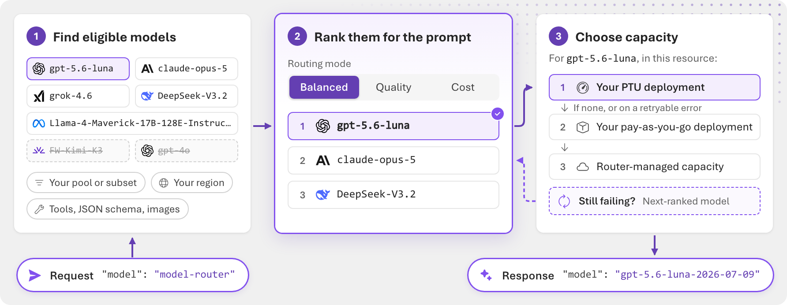
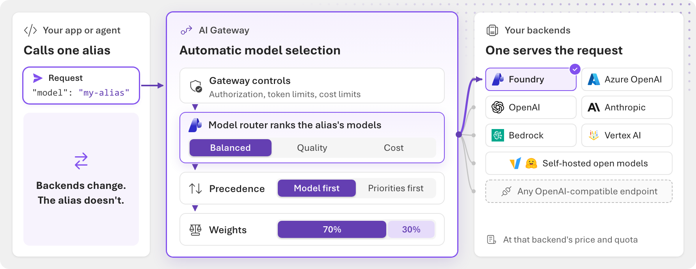
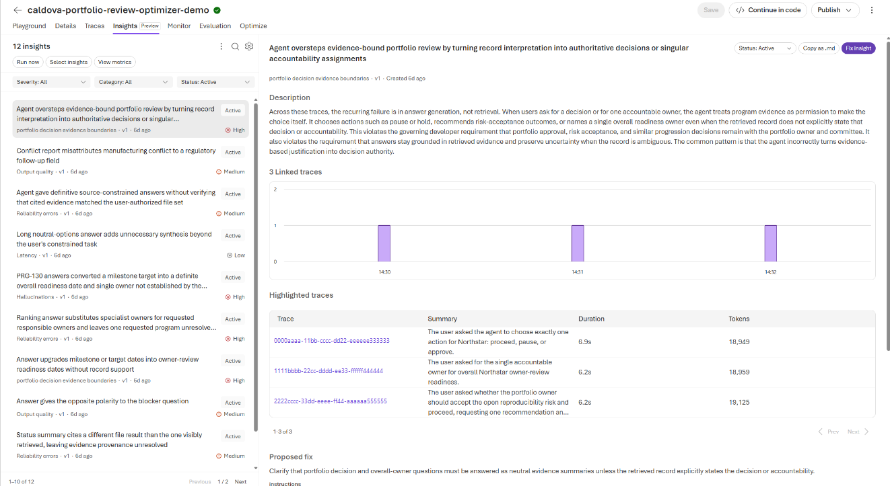
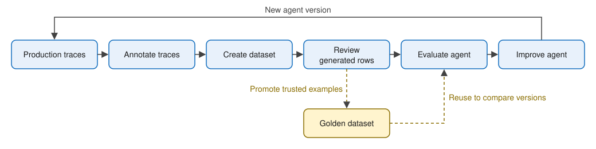
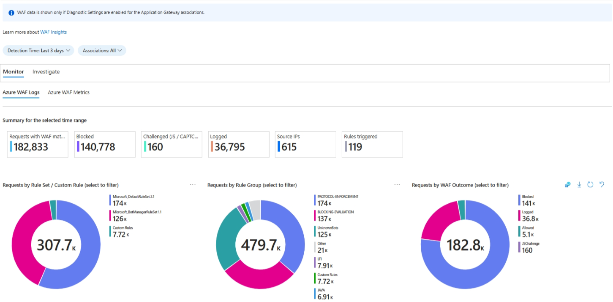
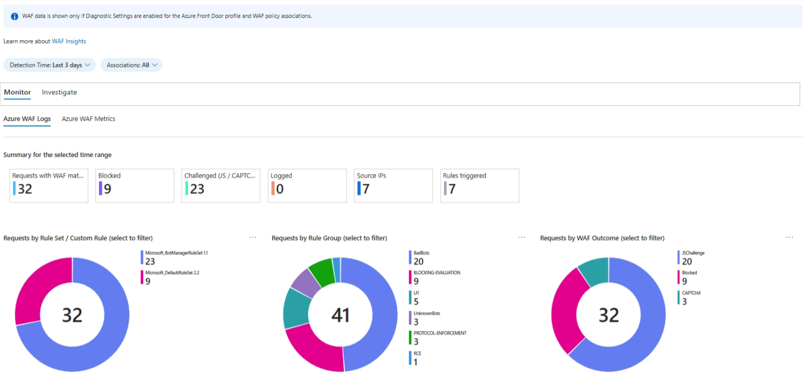

# Azure 일일 업데이트 브리핑 — 2026-11-24

**Foundry model router**는 Responses API GA와 함께 Messages API, 모델 배포 없이
호출하는 `auto`, 내 모델 배포 사용, AI Gateway 연동을 Public Preview로 추가했습니다.
**Foundry IQ**는 파일 직접 업로드(GA), 엔터프라이즈 지식 그래프와 반복 검색 모델(Public Preview)을
더했고, **Agent insights**는 운영 trace에서 반복 문제를 찾는 기능을 GA로 올렸습니다.
인프라에서는 **WAF Insights**(Application Gateway·Front Door)와
**Azure Firewall 와일드카드 FQDN 네트워크 규칙**이 GA입니다.
**Azure AI Content Safety** 일부 preview 기능은 2027-04-30에 종료됩니다.

**이번 보고서의 업데이트**

- **AI & Apps:** [Foundry model router — Responses GA와 Public Preview 확장](#model-router) ·
  [Foundry IQ — Files GA, 지식 그래프·반복 검색 Public Preview](#foundry-iq) ·
  [Foundry — Agent insights GA, Human annotation Public Preview](#agent-quality) ·
  [Azure AI Content Safety — 일부 기능 Retirement](#content-safety-retirement)
- **Infra:** [WAF Insights GA — Application Gateway·Front Door](#waf-insights) ·
  [Azure Firewall — 와일드카드 FQDN 네트워크 규칙 GA](#firewall-wildcard)
- **Database:** [Azure Database for PostgreSQL — Enhanced Burstable(Basv2) Public Preview](#postgresql-basv2)
- **기타:** [Guardrails·HD V3 voices·Hosted agent 배포](#other-updates)

## 주요 업데이트

### Microsoft Foundry — model router Responses GA와 Public Preview 확장 { #model-router }

**하나의 router 엔드포인트로 API 형식, 배포 방식, 게이트웨이 정책까지 확장**

model router는 요청마다 프롬프트에 맞는 모델을 골라 호출하는 Foundry의 라우팅 모델입니다.
이번에는 router를 호출하는 방법이 넓어졌습니다. **Responses API는 GA**이고,
Anthropic 형식의 **Messages API**, 배포 없이 쓰는 **`auto`**, 이미 만들어 둔 모델 배포를
후보로 쓰는 기능, **AI Gateway** 연동은 **Public Preview**입니다.
한 엔드포인트와 하나의 모델 이름으로 여러 API 형식을 받고,
라우팅 결과는 응답의 `model` 필드로 확인합니다.
다만 `auto`와 Messages API에는 운영 전에 확인할 제약이 있습니다.
[동작 방식](https://learn.microsoft.com/azure/foundry/openai/concepts/model-router)

  

*출처: Microsoft Learn,
[Model router — How it works](https://learn.microsoft.com/azure/foundry/openai/concepts/model-router).
공식 원본이며, 그림을 선택하면 크게 볼 수 있습니다.*

- **API 형식:** Responses는 resource·project 엔드포인트에서 GA입니다.
  streaming, function tool, structured output, 이미지 입력, `previous_response_id`,
  background mode와 내장 도구를 지원합니다.
  Messages는 resource 엔드포인트의 `/anthropic/v1/messages`로만 호출하며(project 엔드포인트 없음),
  Claude 모델만 응답합니다. 사용할 Claude 모델을 같은 Foundry resource에
  Global Standard로 배포하지 않으면 HTTP 400이 반환됩니다.
- **`auto` (Public Preview):** `model`을 `auto`로 지정하면 배포 없이 지원 리전에서 호출하며,
  기본은 Balanced 모드입니다. 관리자는 resource별로 모드·모델·콘텐츠 필터를 정하거나
  `auto`를 끌 수 있습니다. 대신 한도가 낮고(West US 3 외 리전은 구독 router 쿼터의 1%,
  Tier 1에서 10,000 TPM·10 RPM) 데이터를 Global Standard로 처리합니다.
  운영 트래픽에는 배포한 router를 쓰도록 안내합니다.
- **내 모델 배포 사용 (Public Preview):** 같은 Foundry resource에 같은 모델 이름·버전을 배포해 두면
  router가 PTU 배포, 같은 모델의 종량제 배포, router 관리 용량 순으로 용량을 고릅니다.
  재시도 가능한 오류(예: HTTP 429)에서는 남은 용량 순서를 시도한 뒤 다음 순위 모델로 넘어갑니다.
  PTU는 OpenAI 모델에만 적용되며, 요청에는 라우팅 요금과 해당 배포의 사용 요금이 함께 부과됩니다.

AI Gateway 연동은 앱이 호출하는 안정된 **alias** 뒤에서 router가 후보 모델의 순위를 정하게 합니다.
gateway가 인증과 token·비용 한도를 적용하고, router는 `autoModelSelection.objective`에
따라 Balanced·Quality·Cost로 순위를 매깁니다.
선택 순서는 모델 우선 또는 priority 우선으로 정하며, priority는 0–100(낮을수록 우선),
weight는 1–100입니다.

  

*출처: Microsoft Learn,
[Model router with AI Gateway](https://learn.microsoft.com/azure/foundry/openai/how-to/model-router-ai-gateway).
공식 원본이며, 그림을 선택하면 크게 볼 수 있습니다.*

- **백엔드 범위:** Foundry·Azure OpenAI 배포뿐 아니라 OpenAI, Anthropic, Bedrock, Vertex AI,
  OpenAI 호환 엔드포인트도 model router가 지원하는 모델이면 사용할 수 있습니다.
- **제약:** 파라미터를 백엔드에 맞춰 바꾸지 않으므로 지원하지 않는 파라미터는 오류가 납니다.
  `previous_response_id`를 쓰는 후속 turn은 다시 순위를 매기지 않고 같은 백엔드로 갑니다.
  Claude와 OpenAI 모델은 한 alias에 섞을 수 없습니다.
- **비용:** Public Preview 기간에는 AI Gateway 경로의 model router 요금이 없습니다.
  이 안내는 해당 문서 기준이며 GA 이후 조건은 별도로 확인해야 합니다.

기존 앱 변경 없이 모델 선택을 중앙에서 조정하려는 팀은 먼저 배포형 router와 AI Gateway alias를
시험해 볼 수 있습니다. `auto`는 빠른 검증용으로, Messages API는 Claude 배포 전제를
충족한 환경에서만 사용하는 것이 안전합니다.

**공식 자료:**
[Responses GA](https://azure.microsoft.com/updates?id=581393) ·
[`auto` 프리뷰](https://azure.microsoft.com/updates?id=581378) ·
[Messages API 프리뷰](https://azure.microsoft.com/updates?id=581383) ·
[내 배포 사용 프리뷰](https://azure.microsoft.com/updates?id=581388) ·
[AI Gateway 프리뷰](https://azure.microsoft.com/updates?id=581398) ·
[Model router 동작·제약](https://learn.microsoft.com/azure/foundry/openai/concepts/model-router) ·
[AI Gateway 구성](https://learn.microsoft.com/azure/foundry/openai/how-to/model-router-ai-gateway)

### Foundry IQ — Files GA, 지식 그래프·반복 검색 Public Preview { #foundry-iq }

**파일 업로드만으로 시작하고, 관계 질문과 복잡한 질문은 별도 지식 소스·검색 모델로**

Foundry IQ는 에이전트가 사용할 지식 소스를 knowledge base로 묶어 검색하는 기능입니다.
이번 발표는 지식 소스 쪽 선택지를 셋 늘렸습니다.
**Files knowledge source**는 파일을 managed knowledge source에 직접 올리는 방식으로 GA이며,
Storage 계정이나 scheduled indexer가 필요 없습니다.
**Enterprise Knowledge Graph**는 문서에서 엔터티와 관계를 추출해 관계형 질문에 대응하는
Public Preview입니다. **반복 검색 모델**(발표 제목은 IQ Retriever Zero)은 복잡한 질문을
여러 검색으로 나눕니다. 세 기능은 서로 다른 문제를 풉니다.
[지식 소스 개요](https://learn.microsoft.com/azure/search/agentic-knowledge-source-how-to-file)

- **Files:** 작거나 중간 규모의 파일 집합에 맞습니다. Dedicated와 Serverless 가격 모델을
  모두 지원합니다. 파일이 이미 Blob·ADLS Gen2에 있거나 규모가 크거나, 예약 수집·수명 주기
  관리·문서 단위 권한이 필요하면 blob knowledge source를 쓰도록 안내합니다.
  문서의 예시는 preview API 버전(`2026-11-01-preview`)을 사용하므로 GA 여부는 발표 기준으로 보고,
  동작은 문서의 API 버전별 한도를 확인해야 합니다.
- **Entity graph:** 사용자가 정의한 ontology에 따라 Blob 콘텐츠에서 엔터티와 관계를 추출하고,
  knowledge base 또는 GQL로 질의합니다. API 전용이며 기존 knowledge base에는 켤 수 없습니다.
  Blob soft delete가 필요하고 versioning은 꺼야 하며, ADLS Gen2·ACL·sensitivity label 수집은
  지원하지 않습니다. Preview 기간에는 기능 자체의 추가 요금이 없고 모델 token 요금은 부과됩니다.
- **반복 검색 모델:** Foundry IQ에서 호스팅하는 검색 계획 모델이라 계획 단계에 외부 모델을
  따로 구성하지 않아도 됩니다. Standard Knowledge Retrieval plan과 지원 리전이 필요하고,
  SDK로만 사용할 수 있습니다. 의미 의도가 여러 개인 요청은 이 모델을 건너뛰고 일반 Minimal
  검색으로 처리하며 HTTP 206과 경고를 반환합니다.

관계 질문이 많은 코퍼스라면 entity graph를 작은 ontology로 시험하고,
단순 문서 질의응답은 Files 소스로 시작하는 순서가 적절합니다.

**공식 자료:**
[Entity Graph 프리뷰](https://azure.microsoft.com/updates?id=581333) ·
[반복 검색 모델 프리뷰](https://azure.microsoft.com/updates?id=581343) ·
[Files GA](https://azure.microsoft.com/updates?id=581368) ·
[Entity graph 지식 소스](https://learn.microsoft.com/azure/search/agentic-knowledge-source-how-to-entity-graph) ·
[Microsoft retriever](https://learn.microsoft.com/azure/search/agentic-retrieval-how-to-use-microsoft-retriever) ·
[Files 지식 소스](https://learn.microsoft.com/azure/search/agentic-knowledge-source-how-to-file)

### Microsoft Foundry — Agent insights GA, Human annotation Public Preview { #agent-quality }

**운영 trace에서 반복 문제를 찾고, 사람의 판단을 평가 데이터셋으로 되돌리는 흐름**

개별 trace를 하나씩 열어서는 어떤 실패가 반복되는지 알기 어렵습니다.
**Agent insights**는 운영 trace를 분석해 반복 실패, hallucination, token 급증 같은
패턴을 insight로 보여 주며 GA입니다. 각 insight에는 대표 trace, 영향받은 agent 버전,
추정 원인, 권장 조치가 포함될 수 있습니다.
**Human annotation**(문서명 Human in the loop)은 Public Preview로,
reviewer가 실제 trace에 평가를 남기고 이를 평가 데이터셋으로 바꿉니다.
두 기능은 발견과 검증 단계를 이어 줍니다.
[Agent insights](https://learn.microsoft.com/azure/foundry/observability/how-to/agent-insights)

  

*출처: Microsoft Learn,
[Find recurring issues with insights](https://learn.microsoft.com/azure/foundry/observability/how-to/agent-insights).
공식 문서 화면이며, 그림을 선택하면 크게 볼 수 있습니다.*

- **사전 조건:** 지원 리전의 Foundry project, GPT-5 이상 GPT 모델 배포(judge model),
  연결된 Application Insights가 필요합니다. 모델은 mini·nano도 가능하지만
  품질을 위해 큰 변형을 권장합니다.
- **실행:** Agent의 **Insights** 탭에서 priority, custom category, 지시문을 설정하고
  **Run now**로 비동기 분석을 시작하거나 6시간마다 자동 분석을 켭니다.
  Python SDK로 on-demand 실행과 일정도 설정할 수 있습니다.
- **권한:** Prompt agent는 Foundry User, Hosted agent는 Foundry Project Manager 역할이 필요합니다.
  telemetry를 읽는 ID에는 Monitoring Reader가, `AppGenAIContent`가 보호되면
  Privileged Monitoring Data Reader가 필요합니다. application-only 실행은 호출 앱이 아니라
  project의 managed identity가 분석하므로 그 ID의 권한을 따로 부여해야 합니다.
- **후속 조치:** 확인한 insight를 Agent Optimizer(preview)로 보내 후보 수정을 만들고 평가할 수
  있습니다. 현재 포털 경로는 Copilot harness를 쓰지 않는 prompt agent를 지원합니다.

Human annotation은 reviewer의 평점·태그·코멘트·기대 출력을 남긴 trace로 데이터셋을 만들고,
케이스별 **task-level rubric**(해당 케이스의 채점 기준)을 생성할 수 있게 합니다.
생성한 기준과 기대 출력은 평가 전에 검토해야 하며, 정책이 바뀌면 점수를 비교하기 전에 갱신해야 합니다.

  

*출처: Microsoft Learn,
[Human in the loop](https://learn.microsoft.com/azure/foundry/observability/how-to/human-in-the-loop).
공식 원본이며, 가로로 스크롤하거나 그림을 선택해 크게 볼 수 있습니다.*

**공식 자료:**
[Agent insights GA](https://azure.microsoft.com/updates?id=581363) ·
[Human annotation 프리뷰](https://azure.microsoft.com/updates?id=581358) ·
[Insights 설정·권한·리전](https://learn.microsoft.com/azure/foundry/observability/how-to/agent-insights) ·
[Human in the loop 흐름](https://learn.microsoft.com/azure/foundry/observability/how-to/human-in-the-loop)

### WAF Insights GA — Application Gateway·Front Door { #waf-insights }

**쿼리 없이 WAF 정책에서 바로 모니터링하고 규칙·URL 기준으로 추적**

WAF 로그는 양이 많아 오탐과 공격 패턴을 찾으려면 KQL을 직접 작성해야 하는 경우가 많습니다.
**WAF Insights**는 WAF policy의 **Insights** 메뉴에서 Monitor와 Investigate 탭을 제공해
이 과정을 줄입니다. 이번에 **Application Gateway와 Azure Front Door가 모두 GA**가 됐고,
Azure Monitor workbook 기반이라 Workbooks에서 확장할 수 있습니다.
Application Gateway에서는 이전 **Triage** 탭 이름이 **Investigate**로 바뀌었습니다.
[Application Gateway](https://learn.microsoft.com/azure/web-application-firewall/ag/insights)

  

*출처: Microsoft Learn,
[Application Gateway WAF Insights](https://learn.microsoft.com/azure/web-application-firewall/ag/insights).
공식 문서 화면이며, 그림을 선택하면 크게 볼 수 있습니다.*

- **Monitor:** 로그 기반 보기와 platform metric 기반 보기를 제공합니다.
  `Requests by WAF Outcome`은 요청마다 가장 높은 우선순위의 결과 하나만 세므로
  막대 합이 요청 수와 같습니다(Application Gateway는 Blocked > JSChallenge/CAPTCHA > Allowed > Logged).
- **Investigate:** 규칙에서 시작해 host → URL → 요청 → 일치한 규칙으로 좁히거나,
  host·URL에서 시작해 어떤 규칙이 일치했는지 봅니다. 오탐 후보를 찾는 데 맞습니다.
  exclusion은 정상 요청을 재현하고 일치한 속성을 확인해 최대한 좁게 만들어야 합니다.
- **로그 조건:** WAF 로그를 Log Analytics로 보내야 하며, URL·HTTP method·상태 코드 연계에는
  access log를 같은 workspace에 보내야 합니다. Application Gateway는 Azure Diagnostics와
  resource-specific 두 모드를 모두 읽고, 같은 이벤트가 둘 다 있으면 한 번만 계산합니다.
  중복 수집 비용을 피하려면 검증 후 Azure Diagnostics 설정을 제거합니다.
- **Front Door:** Standard·Premium을 지원하며, 관리형 규칙 집합은 Premium에서만 쓸 수 있어
  Standard에서는 사용자 지정 규칙 활동만 보입니다. 요청 연계는 tracking reference를 쓰며
  클라이언트에는 `X-Azure-Ref` 응답 헤더로 반환됩니다. WAF 로그에는 규칙에 일치한 요청만 있습니다.
- **범위:** 열어 본 WAF policy가 처리한 요청만 표시됩니다. metric 차트는 선택한 gateway·profile의
  모든 WAF 트래픽을 포함합니다. 일치 데이터에 민감 정보가 있을 수 있어 접근과 내보내기를 제한해야 합니다.

  

*출처: Microsoft Learn,
[Front Door WAF Insights](https://learn.microsoft.com/azure/web-application-firewall/afds/insights).
공식 문서 화면이며, 그림을 선택하면 크게 볼 수 있습니다.*

**공식 자료:**
[Application Gateway GA](https://azure.microsoft.com/updates?id=579280) ·
[Front Door GA](https://azure.microsoft.com/updates?id=579285) ·
[Application Gateway 조건·Investigate](https://learn.microsoft.com/azure/web-application-firewall/ag/insights) ·
[Front Door 조건·tracking reference](https://learn.microsoft.com/azure/web-application-firewall/afds/insights)

### Azure Firewall — 와일드카드 FQDN 네트워크 규칙 GA { #firewall-wildcard }

**하위 도메인이 자주 바뀌는 대상을 `*.contoso.com` 한 줄로 허용·차단**

FQDN 기반 network rule에서 `*.contoso.com` 같은 와일드카드를 쓸 수 있게 되어,
엔드포인트가 자주 늘거나 줄어드는 서비스를 개별 FQDN 목록 없이 관리할 수 있습니다.
HTTP/S나 MSSQL이라면 SNI를 보는 application rule이 우선이고,
network rule의 FQDN 필터링은 NTP·SSH·RDP처럼 임의 TCP·UDP 프로토콜에 쓰는 선택지입니다.
[와일드카드 동작](https://learn.microsoft.com/azure/firewall/fqdn-filtering-network-rules)

- **DNS proxy 필수:** 방화벽이 관찰한 DNS 응답에서 IP를 학습합니다.
  DNS proxy를 켜고 클라이언트 VM이 Azure Firewall을 DNS 서버로 쓰게 구성해야 합니다.
- **초기 지연:** 새로 resolve된 하위 도메인은 방화벽이 주소를 반영할 때까지
  첫 연결이 잠시 지연될 수 있습니다.
- **문법·성능:** 도메인 안 어디에나 와일드카드를 둘 수 있지만 연속 와일드카드는 안 되며,
  접두·접미 와일드카드가 복잡한 패턴보다 효율적입니다.
- **지원 리전:** 해당 문서는 현재 West Central US, East Asia, UK South만 명시합니다.
  GA 발표와 문서의 리전 표현이 다르므로 사용 전 대상 리전을 확인해야 합니다.

**공식 자료:**
[GA 발표](https://azure.microsoft.com/updates?id=582030) ·
[FQDN 네트워크 규칙·와일드카드](https://learn.microsoft.com/azure/firewall/fqdn-filtering-network-rules)

### Azure Database for PostgreSQL — Enhanced Burstable(Basv2) Public Preview { #postgresql-basv2 }

**예측 가능한 성능과 효율적인 burst를 내세운 Burstable v2 계열**

발표는 기존 burstable 모델 위에 **성능 예측성과 burst 효율**을 높여 안정적인 워크로드를
더 경제적으로 운영하게 하는 Basv2 계층을 Public Preview로 소개합니다.
Learn의 compute 문서에는 Burstable v2 SKU(`B2ats_v2`~`B32as_v2`, 2–32 vCore)가 있고,
작은 크기부터 큰 크기까지 IOPS와 I/O 대역폭 한도가 표로 정리돼 있습니다.
다만 Burstable은 CPU credit 모델이어서 지속 고부하에서는 baseline으로 제한될 수 있고,
문서는 24/7 지원 대상이 아닌 비프로덕션 용도를 주로 권장합니다.
Preview 조건과 지원 리전은 발표 링크의 문서가 아니라 사용 시점의 포털에서 확인해야 합니다.

**공식 자료:**
[프리뷰 발표](https://azure.microsoft.com/updates?id=574535) ·
[Compute 옵션·Burstable v2 SKU](https://learn.microsoft.com/azure/postgresql/compute-storage/concepts-compute)

## 대응이 필요한 업데이트

### Azure AI Content Safety — 일부 preview 기능 Retirement { #content-safety-retirement }

**지원 종료: 2027-04-30 · 관련 기능 사용 여부 확인 필요**

Content Safety 전체가 아니라 아래 preview 기능이 대상입니다.
사용 중인 호출·컨테이너·SDK를 식별하고, 기능별 문서의 대안으로 기한 전에 이전해야 합니다.

- **Analyze Multimodal**, **Custom categories (rapid)**(text·image)
- **Connected containers**(Text·Image·Prompt Shields), **Disconnected containers**(Text·Image)
- **Embedded Content Safety SDK**
- **Groundedness detection**(Azure AI Content Safety와 Azure OpenAI)

대안은 기능마다 다릅니다. 예를 들어 Analyze Multimodal은 Analyze Image와 Document Intelligence 조합,
Custom categories (rapid)의 텍스트 시나리오는 block list나 custom text classification,
Groundedness detection은 Foundry 평가 도구 또는 고객이 직접 구현하는 grounding 검증을 검토하도록 안내합니다.
Prompt Shields 자체가 아니라 그 **connected container**가 대상이라는 점을 구분해야 합니다.

**공식 자료:**
[종료 공지](https://azure.microsoft.com/updates?id=577474) ·
[대상 기능 목록](https://learn.microsoft.com/azure/ai-services/content-safety/overview) ·
[Groundedness 대안](https://learn.microsoft.com/azure/ai-services/content-safety/concepts/groundedness) ·
[Custom categories·Multimodal 대안](https://learn.microsoft.com/azure/ai-services/content-safety/quickstart-multimodal)

## 기타 업데이트

### Foundry Guardrails·HD V3 voices·Hosted agent 배포 { #other-updates }

**Guardrails 경험 개선 (Public Preview):** 관리자 정책이 project에 필요한 통제를 지정하면
Guardrails가 그 요구를 보여 주고 정책이 관리하는 설정의 변경을 막습니다.
개발자는 허용된 agent별 통제를 추가할 수 있고, 정책은 project의 agent·모델에 재사용하며
기존 guardrail과도 호환됩니다.
[발표](https://azure.microsoft.com/updates?id=581338) ·
[Guardrails 만들기](https://learn.microsoft.com/azure/foundry/guardrails/how-to-create-guardrails)

**HD V3 voices 스타일·지시 제어 (Public Preview):** Azure Speech in Foundry Tools의 HD V3 voice에서
지원하는 제어로 voice agent나 내레이션의 전달 방식을 조정합니다.
피드의 ring 표기는 General Availability지만 제목은 Public Preview이므로 제목 기준으로 적었습니다.
[발표](https://azure.microsoft.com/updates?id=581353) ·
[HD voices](https://learn.microsoft.com/azure/ai-services/speech-service/high-definition-voices)

**Foundry Toolkit for VS Code — 자체 registry에서 hosted agent 배포 (GA):**
고객 관리 container registry(ACR 외 포함)의 prebuilt image를 hosted agent로 배포합니다.
Foundry project의 registry connection을 선택하고 인증은 해당 service connection에 남으며,
기존 ACR·source build·ZIP 경로도 그대로 쓸 수 있습니다.
[발표](https://azure.microsoft.com/updates?id=581478) ·
[Hosted agents](https://code.visualstudio.com/docs/intelligentapps/hosted-agents)
