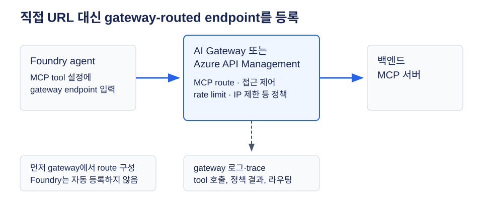
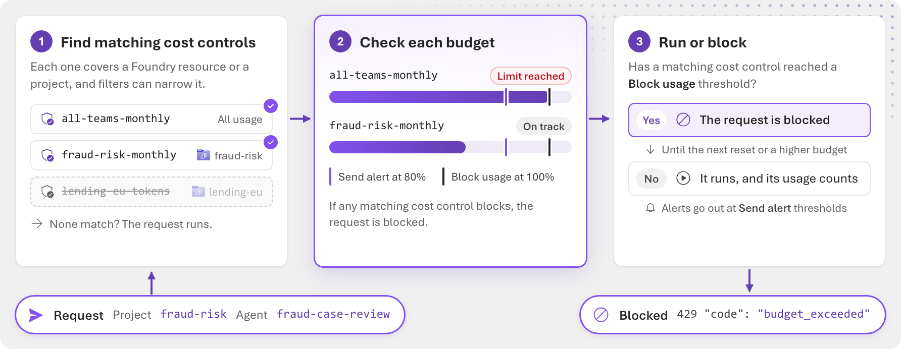
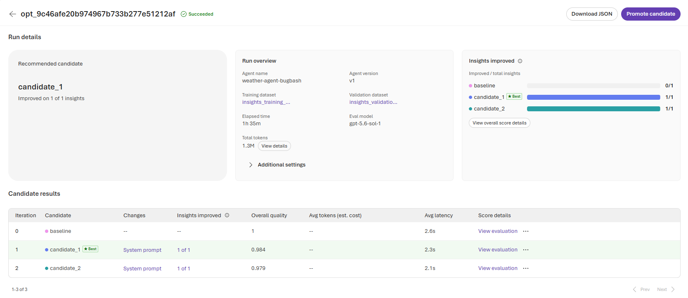

# Azure 일일 업데이트 브리핑 — 2026-11-25

**Foundry Agent Service**는 에이전트를 운영 환경에 올릴 때 필요한 통제 기능을 Public Preview로
확장했습니다. MCP tool 트래픽을 조직의 gateway로 경유시키고, 모델·에이전트 사용량에 예산을
걸고, hosted agent의 outbound 대상을 Azure Policy로 관리합니다.
**Azure AI Search와 Foundry IQ**는 Azure Storage 권한을 검색 결과 필터링에 쓰는 기능이 GA이고,
**Azure Site Recovery**는 Ultra disk VM의 Availability Zone 간 재해 복구를 GA로 지원합니다.

**이번 보고서의 업데이트**

- **AI & Apps:** [Foundry Agent Service — MCP tool gateway 경유 Public Preview](#mcp-gateway) ·
  [Foundry — 비용 통제 Public Preview](#cost-controls) ·
  [Foundry Agent Service — Hosted agent egress 정책 Public Preview](#egress-policy) ·
  [Foundry — insight 기반 Agent 최적화 Public Preview](#optimize-from-insights) ·
  [Azure AI Search·Foundry IQ — Storage 권한 GA](#search-storage-permissions) ·
  [Foundry Agent Service — 네이티브 A2A passthrough Public Preview](#a2a-passthrough)
- **Infra:** [Azure Site Recovery — Ultra disk zonal DR GA](#asr-ultra-zonal)
- **기타:** [azd의 Content Understanding 확장](#other-updates)

## 주요 업데이트

### Foundry Agent Service — MCP tool gateway 경유 Public Preview { #mcp-gateway }

**agent가 호출하는 MCP tool을 조직의 gateway 뒤로 모으는 방법**

MCP(Model Context Protocol) 서버가 늘어나면 어떤 agent가 어떤 tool을 어떤 조건으로 호출하는지
한곳에서 통제하기 어렵습니다. 이번 Public Preview는 Foundry Agent Service의 MCP tool 호출을
조직이 운영하는 **AI Gateway** 또는 **Azure API Management** endpoint로 경유시키는 방법을 제공합니다.
gateway에서 접근 제어와 정책을 적용하고 로그·trace를 남기면서, 개발자는 계속 Foundry에서
agent를 만듭니다. 다만 등록은 자동이 아닙니다. 먼저 gateway에 MCP route를 만들고, 그
endpoint를 Foundry tool에 직접 입력해야 합니다.
[공식 문서](https://learn.microsoft.com/azure/foundry/agents/how-to/tools/governance)

*공식 문서 기반 재구성:
[Govern MCP tools by using a gateway](https://learn.microsoft.com/azure/foundry/agents/how-to/tools/governance).
그림을 선택하면 원본 크기로 볼 수 있습니다.*

- **등록 순서:** gateway에서 route를 구성한 뒤 Foundry 도구 카탈로그 또는 사용자 지정 MCP tool에
  gateway-routed endpoint 전체를 입력합니다.
- **자동화 없음:** Foundry는 MCP 서버를 gateway에 자동 등록하지 않고, 직접 endpoint를 바꿔 주지도 않습니다.
  이전에 자동 등록되던 동작은 중단됐으므로 gateway로 보낼 기존 tool은 하나씩 수정해야 합니다.
- **정책 위치:** rate limit, IP 제한, 헤더 정리, 백엔드 라우팅 같은 정책은 Foundry가 아니라
  AI Gateway 포털 또는 API Management에서 관리합니다.
- **인증:** 관리형 ID(Microsoft Entra), key 기반, custom OAuth identity passthrough, 무인증을
  MCP 서버가 지원하는 범위에서 사용할 수 있습니다.
- **관측:** AI Gateway는 observability 대상을 먼저 구성해야 로그와 trace를 볼 수 있습니다.

이 Preview는 평가용이며 프로덕션 SLA 대상이 아닙니다.

**공식 자료:**
[Azure Updates](https://azure.microsoft.com/updates?id=581498) ·
[Govern MCP tools by using a gateway](https://learn.microsoft.com/azure/foundry/agents/how-to/tools/governance)

### Microsoft Foundry — 모델·에이전트 비용 통제 Public Preview { #cost-controls }

**청구서에 반영되기 전, 요청이 실행되는 시점에 예산을 감시하고 차단**

Azure Cost Management는 비용이 청구 데이터에 나타난 뒤에 확인합니다. Foundry **cost control**은
Foundry resource나 project에 지출 또는 token 예산을 정하고, 요청이 실행되는 동안 사용량을 집계합니다.
임계값에 도달하면 Azure Event Grid로 알림을 보내거나 새 요청을 막습니다.
여러 팀이 같은 모델 배포와 agent를 쓰는 환경에서 한도를 앞단에 두려는 목적입니다.
[개요](https://learn.microsoft.com/azure/foundry/concepts/cost-controls)

*출처: Microsoft Learn,
[Cost controls overview (preview)](https://learn.microsoft.com/azure/foundry/concepts/cost-controls).
공식 원본이며, 그림을 선택하면 크게 볼 수 있습니다.*

- **예산 단위:** 미국 달러 지출 또는 token 수입니다. 범위는 resource 전체이거나 project, 모델 배포,
  agent, hosted agent session 필터로 좁힙니다(session은 최대 20개). 예산은 매일·매주·매월 초기화됩니다.
- **임계값 동작:** Send alert는 Event Grid topic(CloudEvents v1.0)으로 알리고 요청은 계속됩니다.
  Block usage는 새 요청을 HTTP 429(`x-ms-budget-cause: budget_exceeded`)로 거절합니다.
  권장 구성은 80% 알림과 100% 차단입니다.
- **정확도:** 지출 합계는 협상 가격 스냅샷 기준의 추정치이며 청구서와 정산되지 않습니다.
  임계값을 넘긴 그 요청은 완료될 수 있고, 변경은 최대 15분 안에 반영됩니다.
- **지원 범위:** Preview 동안 Azure OpenAI 모델 배포를 지원합니다.

비용 가드레일이지 청구 데이터의 대체물이 아니므로 최종 정산은 Cost Management에서 확인해야 합니다.

**공식 자료:**
[Azure Updates](https://azure.microsoft.com/updates?id=581323) ·
[Cost controls overview](https://learn.microsoft.com/azure/foundry/concepts/cost-controls)

### Foundry Agent Service — Hosted agent egress 정책 Azure Policy 거버넌스 Public Preview { #egress-policy }

**hosted agent이 호출할 수 있는 outbound 대상을 관리자가 정책으로 강제**

Hosted agent은 컨테이너에서 외부 API를 호출하므로 어떤 도메인에 나갈 수 있는지가 보안 요건이 됩니다.
Foundry에서는 RAI policy가 egress 규칙을 저장하고 런타임이 이를 적용합니다.
이번 발표는 그 구성이 조직 기준을 충족하는지 **Azure Policy**로 audit하거나 deny하는 통제를 더합니다.
정책 할당만으로 guardrail이 만들어지거나 agent에 붙지는 않으며, agent 작성자가 규칙을 구성하고
연결해야 합니다.
[공식 문서](https://learn.microsoft.com/azure/foundry/agents/how-to/govern-hosted-agent-egress-azure-policy)

- **정의 4개:** RAI policy의 baseline·endpoint, rewrite 대상, 헤더·자격 증명 안전성을 보는
  control-plane 정의 3개와, hosted agent 버전의 해석된 egress 구성을 보는 data-plane 정의 1개입니다.
  hosted agent가 규정 준수 egress를 갖도록 요구하려면 data-plane 정의도 할당해야 합니다.
- **효과:** `Audit`, `Deny`, `Disabled`이며 기본은 `Audit`입니다. 새 agent 버전 생성 때 deny가
  평가되고, 기존 버전은 백그라운드 평가로 준수 여부만 보고됩니다.
- **전파:** data-plane 할당 변경은 Foundry 평가에 반영되기까지 30–60분을 안내합니다.
  정책 변경이 실행 중인 session을 중단하거나 런타임 규칙을 바꾸지는 않습니다.
- **지원 리전:** 이 거버넌스 연동은 Brazil South, Canada Central, Korea Central, Norway East,
  Southeast Asia, Spain Central에서 Preview입니다. Korea Central이 포함됩니다.
  이 목록은 거버넌스 연동 범위이며 런타임 egress 제어는 별개입니다.
- **범위 제한:** Hosted agent만 대상이며, Copilot harness를 쓰는 prompt agent는 해당하지 않습니다.

**공식 자료:**
[Azure Updates](https://azure.microsoft.com/updates?id=581328) ·
[Govern hosted agent egress with Azure Policy](https://learn.microsoft.com/azure/foundry/agents/how-to/govern-hosted-agent-egress-azure-policy)

### Foundry Agent Service — insight 기반 Agent 최적화 Public Preview { #optimize-from-insights }

**운영 trace에서 찾은 문제를 후보 수정으로 만들고 평가한 뒤 승격**

지난 [11월 24일 브리핑의 Agent insights GA](../2026-11-24/index.md#agent-quality)에 이어,
insight를 실제 수정으로 연결하는 단계가 Public Preview로 추가됐습니다.
Foundry 포털에서 prompt agent의 insight를 골라 **Agent Optimizer** 실행을 만들면, 현재 버전을
기준으로 instructions와 function-calling tool 설명의 후보 변경을 생성하고 평가합니다.
기존에는 insight를 확인한 뒤 사람이 수정하고 다시 평가해야 했습니다.
[공식 문서](https://learn.microsoft.com/azure/foundry/agents/how-to/optimize-agents-from-insights)

*출처: Microsoft Learn,
[Fix insights with agent optimizer (preview)](https://learn.microsoft.com/azure/foundry/agents/how-to/optimize-agents-from-insights).
공식 문서 화면이며, 그림을 선택하면 크게 볼 수 있습니다.*

- **흐름:** Insights 탭에서 고칠 insight를 선택하고 baseline 버전, optimization model,
  최대 후보 수, evaluation model을 확인해 실행합니다.
- **결과 해석:** 주 지표는 선택한 insight 중 후보가 개선한 수이고, 일반 품질 평가는 회귀 확인용입니다.
  선택한 insight를 하나 이상 개선하면 일반 품질이 최대 2% 하락해도 통과할 수 있어
  두 결과를 함께 보고 승격해야 합니다.
- **변경 범위:** 후보는 instructions와 tool 설명을 바꾸며 모델과 skill은 바꾸지 않습니다.
  실행은 승격하기 전까지 활성 agent를 바꾸지 않습니다.
- **주의:** 평가 중 tool이 실제로 호출되므로 운영 시스템을 바꾸는 tool은 읽기 전용 권한이나
  격리된 테스트 리소스로 제한해야 합니다.
- **대상:** 포털 흐름은 Copilot harness를 쓰지 않는 prompt agent만 지원합니다.
  hosted agent는 Foundry Toolkit(VS Code) 또는 azd `microsoft.foundry` 확장 흐름을 씁니다.

**공식 자료:**
[Azure Updates](https://azure.microsoft.com/updates?id=581483) ·
[Fix insights with agent optimizer](https://learn.microsoft.com/azure/foundry/agents/how-to/optimize-agents-from-insights) ·
[Hosted agent 최적화 퀵스타트](https://learn.microsoft.com/azure/foundry/agents/quickstarts/quickstart-optimize-hosted-agent)

### Azure AI Search·Foundry IQ — Azure Storage 권한 활용 GA { #search-storage-permissions }

**문서별 보안 필터를 따로 만들지 않고 Storage의 권한을 검색 결과에 반영**

RAG나 agent 검색에서 사용자가 볼 수 없는 문서가 답변에 섞이지 않게 하려면 보안 필터를 직접
설계해야 했습니다. 이번 GA로 Azure AI Search와 Foundry IQ는 지원되는 Azure Storage 권한을
색인 시점에 수집하고, 질의 시점에 호출 사용자의 Microsoft Entra 토큰으로 결과를 걸러 낼 수 있습니다.
[문서 수준 접근 제어](https://learn.microsoft.com/azure/search/search-document-level-access-overview)

- **ADLS Gen2:** 지원되는 ACL, container 수준 RBAC 또는 둘 다 사용합니다.
- **일반 Blob Storage:** container 수준 RBAC만 지원하며 개별 blob ACL은 지원하지 않습니다.
- **질의:** `Authorization`은 Search를 호출하는 앱의 RBAC이고, 사용자 문서 권한 평가는
  `x-ms-query-source-authorization` 헤더의 위임된 사용자 토큰이 담당합니다.
- **버전·SDK:** 문서는 이 기능이 REST API `2026-10-01`에서 GA라고 설명하며, SDK 지원은
  패키지 changelog에서 따로 확인하라고 안내합니다.
- **제약:** 권한 수집 시 `json`, `jsonLines`, `delimitedText`, `text`, `markdown` 같은
  특수 parsing mode는 지원하지 않고 기본(default) 파싱을 사용해야 합니다.
  Microsoft Purview 민감도 레이블 적용은 여전히 Preview입니다.

**공식 자료:**
[Azure Updates](https://azure.microsoft.com/updates?id=581303) ·
[Document-level access control](https://learn.microsoft.com/azure/search/search-document-level-access-overview)

### Foundry Agent Service — hosted agent 네이티브 A2A passthrough Public Preview { #a2a-passthrough }

**A2A agent를 Responses 프로토콜 변환 없이 그대로 호스팅**

**A2A(Agent2Agent)** 는 agent끼리 작업을 위임하는 프로토콜입니다. 이전에는 Agent Service가 들어온
A2A 요청을 Responses 프로토콜로 변환해 전달했습니다. 이번 Preview에서는 네이티브 A2A 요청을
hosted agent 컨테이너로 그대로 전달하므로, 이미 A2A로 만든 agent의 코드가 A2A 메시지와 task를
직접 처리합니다. Agent Service는 endpoint, 인증, hosted compute를 맡습니다.
[Hosted agents 개요](https://learn.microsoft.com/azure/foundry/agents/concepts/hosted-agents)

- **지원:** 들어오는 A2A v1.0 요청을 JSON-RPC로 받습니다.
- **미지원:** streaming, push notification, 인증된 extended agent card는 Preview에서 제공되지 않습니다.
- **방향:** 들어오는 요청만 다루며 다른 agent로 나가는 호출 구성은 포함하지 않습니다.
- **확인 필요:** Hosted agents 개요 문서에는 A2A 요청 형식 제약(단일 turn `SendMessage`, `GetTask` 미지원)이
  따로 적혀 있어 passthrough에 그대로 적용되는지 이번 자료로 확정하지 못했습니다.
  도입 전에 최신 문서를 확인해야 합니다.

**공식 자료:**
[Azure Updates](https://azure.microsoft.com/updates?id=581313) ·
[What are hosted agents?](https://learn.microsoft.com/azure/foundry/agents/concepts/hosted-agents)

### Azure Site Recovery — Ultra disk zonal DR GA { #asr-ultra-zonal }

**고성능 Ultra disk VM도 같은 리전의 다른 Availability Zone으로 복구**

Ultra disk는 지연 시간과 IOPS 요구가 큰 워크로드에 쓰입니다. 이전에는 이 디스크를 쓰는 VM이
Azure Site Recovery의 zone-to-zone 재해 복구를 함께 쓸 수 없었습니다. 이번 GA로 Ultra disk가 있는
Azure VM을 한 zone에서 같은 리전의 다른 zone으로 복제하고 복구할 수 있어, zone 장애에 대비하면서
디스크 유형을 바꾸지 않아도 됩니다.
[What's new in Site Recovery](https://learn.microsoft.com/azure/site-recovery/feature-updates-whats-new#azure-site-recovery-support-for-zonal-disaster-recovery-for-ultra-disks)

- **범위:** 같은 리전 안의 zone 간 복구이며 리전 장애 대응은 아닙니다.
- **제한:** 같은 문서는 Ultra Disk를 온-프레미스에서 Azure로의 보호 대상 디스크 유형으로는
  지원하지 않는다고 안내합니다.
- **리전:** 이번 자료에는 지원 리전 목록이 없으므로 도입 전에 Site Recovery 지원 매트릭스를 확인해야 합니다.

**공식 자료:**
[Azure Updates](https://azure.microsoft.com/updates?id=582171) ·
[What's new in Site Recovery](https://learn.microsoft.com/azure/site-recovery/feature-updates-whats-new#azure-site-recovery-support-for-zonal-disaster-recovery-for-ultra-disks)

## 기타 업데이트 { #other-updates }

- **Azure Developer CLI — Content Understanding 확장 Public Preview:**
  `azd ai cu` 명령으로 Document Intelligence·Content Understanding 분석 결과를 Markdown이나 JSON으로
  저장합니다. azd 1.37.0 이상이 필요하고 Python이나 azd 프로젝트 초기화 없이 `prebuilt-layout`으로 시작할 수 있습니다.
  [원문](https://azure.microsoft.com/updates?id=581318) ·
  [퀵스타트](https://learn.microsoft.com/azure/ai-services/content-understanding/quickstart/use-content-understanding-cli)
