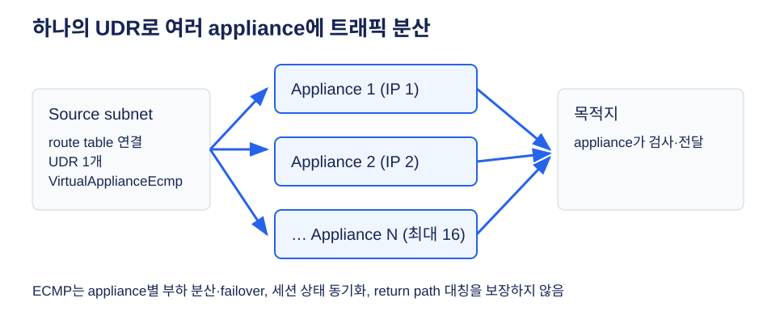

# Azure 일일 업데이트 브리핑 — 2026-11-26

**Azure Virtual Network**는 하나의 사용자 정의 경로(UDR)에 여러 네트워크 어플라이언스를 next hop으로
지정하는 **ECMP**를 Public Preview로 제공합니다. **Azure Functions**는 Java 8·11·17 지원이
2027-09-01에 종료된다고 공지했습니다.

> **기한 경고:** Azure Functions의 Java 8·11·17은 **2027-09-01**에 지원이 종료됩니다.

**이번 보고서의 업데이트**

- **AI & Apps:** [Azure Functions — Java 8·11·17 Retirement](#functions-java-retirement)
- **Infra:** [Azure Virtual Network — ECMP next hop Public Preview](#vnet-ecmp)

## 주요 업데이트

### Azure Virtual Network — UDR ECMP next hop Public Preview { #vnet-ecmp }

**하나의 UDR로 여러 NVA에 트래픽을 나누는 방법**

Azure Virtual Network에서 방화벽·검사 장비 같은 NVA(network virtual appliance)를 거치게 하려면
UDR의 next hop을 appliance IP로 지정합니다. 이 방식은 한 경로가 한 appliance를 가리키므로,
처리량이 한 대의 한계를 넘으면 appliance를 늘리고 경로·부하 분산 구성을 따로 설계해야 했습니다.
이번 Public Preview의 **Equal-Cost Multi-Path(ECMP)** 는 하나의 UDR에 2~16개 next hop IP를 넣어
같은 prefix의 트래픽을 여러 appliance로 나누게 합니다. 같은 목적지에 경로를 여러 개 만들 필요가 없고,
appliance 한 대의 처리 한계를 넘는 대역폭이 필요한 AI 워크로드, 대규모 데이터 플랫폼,
hub-and-spoke 구성을 대상으로 합니다.

*공식 문서 기반 재구성:
[Equal-cost multipath routing for user-defined routes](https://learn.microsoft.com/azure/virtual-network/virtual-networks-udr-overview#equal-cost-multipath-routing-for-user-defined-routes-public-preview).
그림을 선택하면 원본 크기로 볼 수 있습니다.*

- **구성:** next hop 타입은 `VirtualApplianceEcmp`이며 route마다 2~16개 IP를 지정합니다.
  Azure CLI는 `--next-hop-ip-address` 대신 `--next-hop`의 `next-hop-ip-addresses` 목록을 씁니다.
- **경로 선택:** Azure는 기존 라우팅 규칙으로 경로를 먼저 고른 뒤 그 경로의 next hop 사이에 트래픽을 분산합니다.
- **사전 작업:** 경로가 있는 각 subscription에 `Microsoft.Network/AllowEcmpInRoute` feature를 등록하고,
  각 NVA의 NIC와 OS에서 IP forwarding을 켭니다. NVA는 source workload와 다른 subnet에 두어
  라우팅 루프를 피합니다.

**알아둘 제한:** ECMP는 appliance 단위 부하 분산이나 failover를 제공하지 않습니다.
NVA 간 세션 상태 동기화와 return path 대칭도 보장하지 않으므로 stateful appliance는 벤더 요구 사항을
확인해야 합니다. next hop 구성원을 바꾸면 기존 연결에 영향이 있을 수 있습니다.

**공식 자료:**
[Azure Updates](https://azure.microsoft.com/updates?id=582326) ·
[UDR 개요의 ECMP 절](https://learn.microsoft.com/azure/virtual-network/virtual-networks-udr-overview#equal-cost-multipath-routing-for-user-defined-routes-public-preview) ·
[ECMP 구성 튜토리얼](https://learn.microsoft.com/azure/virtual-network/tutorial-create-route-table#configure-ecmp-routing-optional)

## 대응이 필요한 업데이트

### Azure Functions — Java 8·11·17 Retirement { #functions-java-retirement }

**지원 종료: 2027-09-01 · 사용 중인 Java 버전 확인 필요**

종료 대상은 Azure Functions에서 실행하는 **Java 8, 11, 17** 런타임입니다.
공식 공지는 종료일 이후에도 앱이 계속 실행되지만 security update와 고객 지원은 제공되지 않는다고 설명합니다.
공식 권고는 종료일 전에 Function app을 **Java 25**로 올리는 것입니다.

- **지원 기간:** Java 25는 2029년 5월, Java 21은 2028년 9월까지 지원됩니다.
- **Linux Consumption:** Java 21이 마지막 지원 버전이며 더 높은 Java는 추가되지 않습니다.
  Linux Consumption 앱은 Java 25를 쓸 수 없으며, 공식 문서는 Flex Consumption 계획 이전 안내를 제공합니다.
- **준비:** 업그레이드 전에 extension bundle, binding extension, package 의존성과 로컬 도구가
  새 Java 버전과 호환되는지 확인하고 로컬에서 먼저 검증합니다.

**공식 자료:**
[Azure Updates](https://azure.microsoft.com/updates?id=568586) ·
[언어 버전 업데이트](https://learn.microsoft.com/azure/azure-functions/update-language-versions) ·
[지원 언어 버전](https://learn.microsoft.com/azure/azure-functions/supported-languages)
